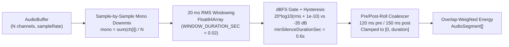

# Spec 01 — DSP Silence Detection Engine (`design.md`)

## Architectural Role
`src/dsp/silenceDetector.ts` is Stage 1 of StitchCut's browser-native condensing pipeline. After `AudioContext.decodeAudioData` decodes a specimen's audio track in `src/App.tsx`, `detectActiveSegments` converts raw `Float32Array` PCM channels into coalesced, energy-scored `AudioSegment[]` intervals ready for time-budgeted selection.



## Key Implementation Decisions

### 1. Sample-Level Downmix Prior to Squaring (`lines 25–30`)
Rather than computing per-channel RMS and averaging afterward, `detectActiveSegments` sums `channel[sample]` across all `numberOfChannels` at each sample index `sample` before squaring:
```ts
let channelSum = 0;
for (const channel of channels) channelSum += channel[sample];
const mono = channelSum / numberOfChannels;
sumOfSquares += mono * mono;
```
This matches standard mono sum behavior in broadcast loudness/FFmpeg `pan=mono` downmixing and is directly tested in `tests/silenceDetector.test.ts` (`downmixes channels sample by sample before taking RMS`).

### 2. `Float64Array` Window Accumulator & `-200 dBFS` Floor (`lines 16, 58`)
- Window RMS values are stored in `Float64Array(Math.ceil(length / windowSize))` to eliminate single-precision drift across 10-minute (`600 s` = `30,000` windows) recordings.
- Adding `1e-10` inside `20 * Math.log10(rmsByWindow[index] + 1e-10)` floors digital zero at `-200 dBFS`, avoiding `-Infinity` arithmetic branches.
- An early `hasSignal` boolean short-circuits pure-zero buffers in `O(N)` before segment allocation.

### 3. Single-Pass State Machine with Sentinel Flush (`lines 54–69`)
- `activeStart` tracks the start window of the current retained region; `silenceStart` tracks the start of the current quiet run.
- Iterating `index` from `0` to `rmsByWindow.length` (inclusive sentinel at `index === rmsByWindow.length`) ensures trailing silence `>= minSilenceDurationSec` is stripped cleanly without duplicating loop-tail logic, while trailing silence shorter than `minSilenceDurationSec` stays attached to the preceding speech burst.

### 4. Exact Partial-Window Overlap Weighting (`lines 71–82`)
Because `preRollMs` (`120 ms`) and `postRollMs` (`150 ms`) need not align to `20 ms` window boundaries (e.g., `150 ms = 7.5` windows), `segment.energy` computes exact temporal intersection `overlap = Math.min(segment.end, windowTime(index + 1)) - Math.max(segment.start, start)` for every window covering `[segment.start, segment.end]`.

## Default Studio Parameters (`src/App.tsx`)
| Parameter | Default | UI Slider Range (`ControlPanel.tsx`) | Purpose |
| :--- | :--- | :--- | :--- |
| `silenceThresholdDb` | `-35 dB` | `-60 dB` to `-10 dB` | Gate separating speech/demo audio from room noise |
| `minSilenceDurationSec` | `0.6 s` | `0.1 s` to `3.0 s` | Minimum dead-air span excised |
| `preRollMs` | `120 ms` | Fixed readout | Preserves consonant attack before speech onset |
| `postRollMs` | `150 ms` | Fixed readout | Preserves natural syllable decay after speech release |
