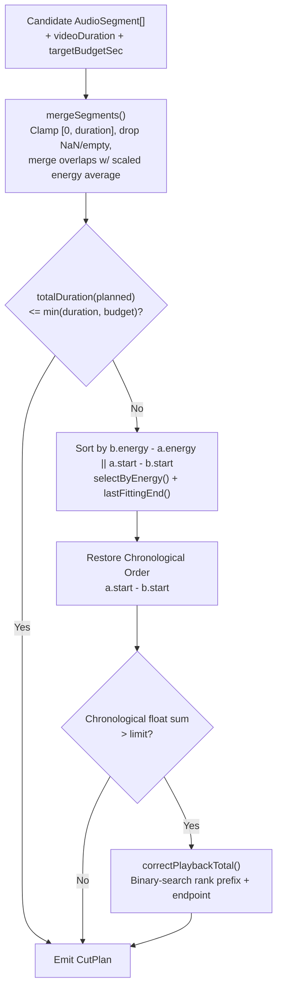

# Spec 02 — Deterministic Segment Planner & PBT Invariants (`design.md`)

## Architectural Role
`src/planner/segmentPlanner.ts` is the mathematical core of StitchCut. Given noisy or dense `AudioSegment[]` intervals from `detectActiveSegments` and a user-configured `targetBudgetSec` (e.g., `180 s` for a 3-minute hackathon submission), it produces a mathematically verified `CutPlan` guaranteed never to exceed the target budget by even 1 ULP (unit in the last place).



## Numerical Precision Engineering

### 1. Overflow-Safe Duration-Weighted Energy Merging (`mergeSegments`, `lines 36–53`)
When two overlapping or touching segments (`segment.start <= previous.end`) merge, `mergeSegments` normalizes weights by `scale = Math.max(weightScale, length)` and updates `previous.energy` incrementally:
```ts
const scale = Math.max(weightScale, length);
const weight = length / scale;
totalWeight = totalWeight * (weightScale / scale) + weight;
weightScale = scale;
previous.energy += (segment.energy - previous.energy) * (weight / totalWeight);
```
This preserves exact weighted averages across extreme duration ratios without `Infinity` overflow.

### 2. IEEE-754 Bisection Trimming (`lastFittingEnd`, `lines 57–65`)
In IEEE-754 double precision, `start + (limit - used)` can round up by 1 ULP, causing `used + (trimmedEnd - start) > limit` (for example, `start = 1, end = 2, budget = 0.1` or `start = 2**52`). `lastFittingEnd(low, high, fits)` bisects `mid = low + (high - low) / 2` until `mid === low || mid === high`, returning the exact largest IEEE-754 float `end` that satisfies `fits(end)`. If `trimmedEnd === start` (when remaining budget is smaller than float precision at `2**52`), the planner cleanly skips that trim and continues scanning lower-ranked segments that start earlier where float precision is finer (`tests/planner.pbt.test.ts`, line 116).

### 3. Non-Associative Float Summation Correction (`correctPlaybackTotal`, `lines 95–123`)
Floating-point addition `(a + b) + c !== (c + a) + b` is non-associative: segments selected in energy order with sum `<= limit` can occasionally round above `limit` when re-summed in chronological playback order. `correctPlaybackTotal` binary-searches the energy-ranked prefix and bisects the cutoff segment's `end` evaluated directly against `totalDuration(corrected) <= limit` in chronological order.

## Property-Based Verification (`tests/planner.pbt.test.ts`)
- Adversarial `fast-check` arbitraries generate `NaN`, `Infinity`, `-Infinity`, negative timestamps, inverted intervals (`start > end`), zero/negative budgets, and arrays up to 40 segments across `numRuns: 1000`.
- Every generated plan asserts `validateCutPlan(plan, duration, budget).valid === true`, idempotence, and input-reversal invariance (`[...segments].reverse()`).
