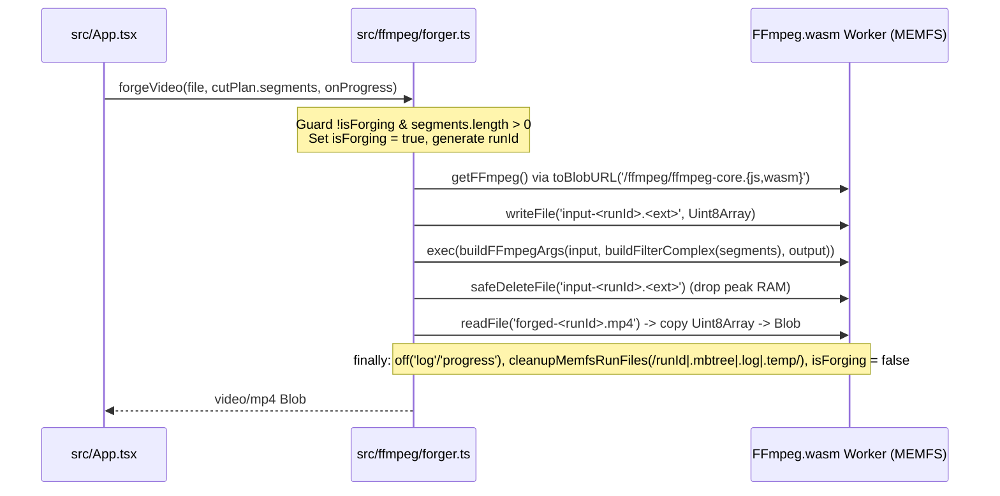

# Spec 03 — Self-Hosted FFmpeg.wasm Forger & MEMFS Hygiene (`design.md`)

## Architectural Role
`src/ffmpeg/forger.ts` executes Stage 3 of StitchCut's browser pipeline: taking the user's raw `File` and the planner's validated `AudioSegment[]` and splicing them into a frame-accurate H.264/AAC `.mp4` `Blob` entirely inside Emscripten's in-memory filesystem (`MEMFS`).

## Key Engineering Decisions

### 1. Zero-CDN COEP-Safe Bootstrapping (`getFFmpeg`, `lines 31–103`)
Under `Cross-Origin-Embedder-Policy: require-corp`, fetching worker scripts or `.wasm` binaries from external CDNs without CORP headers is a common failure point during offline/firewalled judging. Bundling `@ffmpeg/core` (`0.12.10`) directly into `public/ffmpeg/ffmpeg-core.js` and `public/ffmpeg/ffmpeg-core.wasm` and converting them via `toBlobURL` guarantees offline resilience and COEP compliance. If `ffmpeg.load()` fails, temporary `coreURL` and `wasmURL` blob URLs are immediately revoked (`lines 90–91`) and `loadPromise` is reset so retries can succeed.

### 2. Peak-Memory Reduction & Scratch Sweep (`lines 129–156, 322–360`)
Browser WASM linear memory is capped (typically 2–4 GB). Holding `input-<runId>`, `x264` lookahead `.mbtree` files, `forged-<runId>.mp4` in MEMFS, and the JavaScript `Blob` copy simultaneously can triple memory consumption. StitchCut mitigates this in two stages:
1. **Eager Input Eviction**: `await safeDeleteFile(ffmpeg, inputName)` runs immediately after `ffmpeg.exec(args)` returns `0`, prior to `ffmpeg.readFile(outputName)`.
2. **Guaranteed `finally` Sweep**: `cleanupMemfsRunFiles` inspects `ffmpeg.listDir('/')` and purges any leftover file matching `runId` or ending in `.mbtree`, `.log`, or `.temp`, swallowing individual `deleteFile` errors so every candidate is attempted.

### 3. Dependency Injection Hook for Deterministic Fast Tests (`__setForgerDepsForTests`)
Running full WebAssembly H.264 encodes inside Node Vitest workers is slow and brittle. Exporting `__setForgerDepsForTests(deps)` (`lines 24–29`) allows `tests/hardening.test.ts` to inject simulated `FFmpeg` mocks that deterministically test non-zero exit codes, `deleteFile` exceptions, `.mbtree` sweeps, and overlapping `forgeVideo` concurrency barriers in `< 15 ms`.
