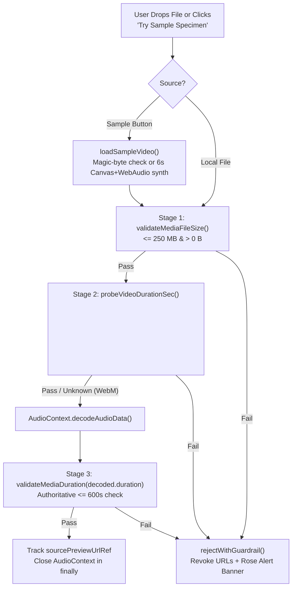

# Spec 04 — Input Guardrails, ObjectURL Lifecycle & Sample Synthesis (`design.md`)

## Architectural Role
Because StitchCut runs 100% client-side inside browser tab memory, unbounded multi-gigabyte uploads or leaked `blob:` URLs would crash the tab with an Out-Of-Memory (OOM) fault. Equally important for hackathon evaluation, judges may not have a raw screen recording handy containing clean speech-and-silence intervals. Spec 04 solves both reliability and zero-friction onboarding.

## Key Engineering Details

### 1. Three-Layer OOM Prevention (`src/mediaGuardrails.ts` & `src/App.tsx`)
1. **Pre-Read Byte Check (`validateMediaFileSize`)**: Blocks `> 250 MB` (`MAX_FILE_SIZE_BYTES`) before `nextFile.arrayBuffer()` allocates a contiguous `ArrayBuffer` on the JS heap.
2. **Off-DOM Metadata Probe (`probeVideoDurationSec`)**: Rejects a compressed 120 MB, 45-minute lecture MP4 in `< 50 ms` before `decodeAudioData` expands it into `~1 GB` of 32-bit float PCM samples. Uses a settled flag, `3000 ms` timeout, `video.removeAttribute('src'); video.load()`, and `URL.revokeObjectURL(tempUrl)`.
3. **Post-Decode Duration Verification (`validateMediaDuration`)**: `MediaRecorder` WebM blobs often omit duration in EBML headers (`video.duration === Infinity`), causing Stage 2 to return `null`. Stage 3 inspects `decoded.duration` right after `decodeAudioData` and rejects any clip `> 600 s`.

### 2. Race-Proof Epoch & `ObjectURL` Accounting (`src/App.tsx`)
- Every call to `analyzeFile` or `handleClearFile` increments `mediaEpochRef.current`.
- After every `await` boundary (`probeVideoDurationSec`, `decodeAudioData`, `forgeVideo`), `App.tsx` checks `mountedRef.current && epoch === mediaEpochRef.current`. If superseded, any newly minted `ObjectURL` is immediately revoked (`URL.revokeObjectURL(url)`).

### 3. Background-Tab-Safe Specimen Synthesizer (`src/components/sampleGenerator.ts`)
- **SPA Fallback Immunity**: `hasValidVideoSignature` inspects the first 12 bytes for ISO-BMFF `ftyp` (`0x66 0x74 0x79 0x70` at offset 4) or Matroska/WebM EBML (`0x1A 0x45 0xDF 0xA3` at offset 0).
- **Continuous Audio Clock**: `synthesizeTestClip` maintains a `SILENT_FLOOR = 0.00001` (`-100 dBFS`) triangle oscillator baseline between the three active chord bursts (`261.63 Hz`, `329.63 Hz`, `392.0 Hz` at `0.32` gain) so `MediaRecorder` Opus/AAC encoders never drop silent packets or desync timestamps.
- **`setInterval` Frame Pacing**: Drives canvas rendering via `setInterval` (`~42 ms` at `24 fps`) rather than `requestAnimationFrame` so synthesis completes reliably in `6.0 s` even if the user switches browser tabs.
