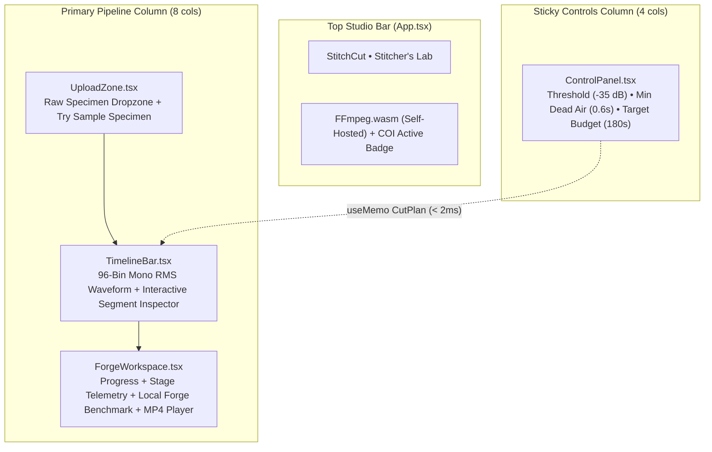

# Spec 05 — Interactive Waveform Timeline, Benchmark Telemetry & COOP/COEP Studio (`design.md`)

## Architectural Role
 StitchCut's browser UI ("Stitcher's Lab") exposes every stage of the deterministic condensing pipeline transparently: raw specimen ingestion, 96-bin mono RMS waveform inspection, real-time threshold/budget tuning, live FFmpeg stage telemetry, and post-forge performance benchmarking.

## Key UI Engineering Decisions

### 1. Bounded-Cost Strided Waveform Extraction (`TimelineBar.tsx`, `lines 34–83`)
A 10-minute stereo 48 kHz `AudioBuffer` holds `57,600,000` float samples. Iterating every sample on React renders would block the main thread. `computeWaveformBins` partitions the buffer into `96` bins and strides each bin by `Math.max(1, Math.floor(span / 256))` (at most `96 * 256 = 24,576` sample reads total), memoized exclusively on `[audioBuffer]`. Adjusting `SilenceConfig` sliders re-colors retained vs. excised bins in `< 1 ms` without recomputing waveform amplitudes.

### 2. High-Resolution Local Forge Benchmark (`App.tsx` & `ForgeWorkspace.tsx`)
- `analyzeFile` brackets `arrayBuffer() + decodeAudioData() + detectActiveSegments() + planCutSegments()` with `performance.now()` to capture `dspAnalyzeMs`.
- `handleForge` brackets `forgeVideo(...)` with `performance.now()` to capture `elapsedMs` and constructs `ForgeBenchmark`.
- `formatElapsed(ms)` displays sub-second runs as `845 ms (0.85 s)` and multi-second runs as `1.42 s (1,420 ms)`, pairing raw engineering precision with human readability alongside the `0 Bytes Uploaded • Zero-Server Privacy` badge.

### 3. Deployment-Parity COOP/COEP Headers (`vite.config.ts` & `vercel.json`)
Both local development/preview (`vite.config.ts`) and static edge hosting (`vercel.json`) apply identical headers on `/(.*)`:
- `Cross-Origin-Opener-Policy: same-origin`
- `Cross-Origin-Embedder-Policy: require-corp`
This guarantees `window.crossOriginIsolated === true` in production deployments just as in `npm run dev`.
