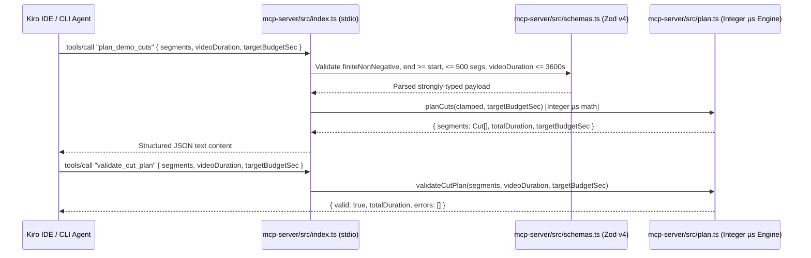

# Spec 06 — MCP Stdio Server & Strict Zod Boundary Orchestration (`design.md`)

## Architectural Role
StitchCut supports **Dual Demonstration & Execution Modes**:
1. **Interactive Zero-Server Browser Studio** (`src/`) for visual waveform inspection and WASM MP4 stitching.
2. **Agentic MCP Server** (`mcp-server/`) enabling Kiro IDE and CLI agents to plan and audit deterministic video cut lists programmatically over stdio (for example, pairing FFmpeg `silencedetect` logs or transcript timestamps with StitchCut's energy-budgeted cut planner).

## Key Design Decisions

### 1. Defense-in-Depth Zod Schemas (`mcp-server/src/schemas.ts`)
LLM tool invocations frequently hallucinate unbounded arrays, negative durations, or non-finite numbers when parsing upstream command output. `schemas.ts` enforces strict invariants at the protocol perimeter:
- `finiteNonNegative = z.number().finite().min(0)` blocks `NaN`, `Infinity`, `-Infinity`, and negatives.
- `.refine((seg) => seg.end >= seg.start)` blocks inverted intervals.
- `z.array(...).max(MAX_SEGMENTS)` (`500`) prevents algorithmic complexity abuse.
- `z.number().finite().positive().max(MAX_VIDEO_DURATION_SEC)` (`3600` s = 1 hour) bounds CLI workflows cleanly.

### 2. Exact Integer Microsecond Arithmetic (`mcp-server/src/plan.ts`)
Inside `mcp-server/src/plan.ts`, timestamps are converted to integer microseconds (`const toUs = (sec: number) => Math.round(sec * 1e6)`). Because `3600 * 1e6 = 3.6e9` fits well inside `Number.MAX_SAFE_INTEGER` (`9.007e15`), all duration additions, subtractions (`remaining = budgetUs - totalUs`), and partial segment trims (`seg.start + remaining`) execute as exact integer operations with zero floating-point drift before converting back via `toSec(us) = us / 1e6`.

### 3. Zero-Dependency Native Test Runner (`mcp-server/src/plan.test.ts`)
`mcp-server` keeps its dependency tree minimal (`@modelcontextprotocol/sdk` and `zod` only) and runs 6 comprehensive unit and adversarial schema tests directly via Node's built-in `node:test` and `node:assert/strict` (`tsc && node --test dist/plan.test.js`).
