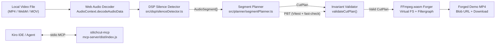

# StitchCut — Architecture & Design

## System Overview
StitchCut follows a strict **Zero-Server, Local-First Pipeline** inside a cross-origin isolated browser tab (`COOP: same-origin`, `COEP: require-corp`). All heavy media computation runs locally using Web Audio API and FFmpeg.wasm, while pure TypeScript DSP and planning modules are shared conceptually with Vitest/fast-check property tests and the local Kiro MCP server.

## Module Boundaries & Shared Contracts (`src/types.ts`)
All modules communicate through four immutable data contracts:
- `SilenceConfig`: User-tunable DSP & budget parameters (`silenceThresholdDb`, `minSilenceDurationSec`, `preRollMs`, `postRollMs`, `targetBudgetSec`).
- `AudioSegment`: Half-open time interval `{ start, end, energy }` in seconds with normalized/RMS energy metadata.
- `CutPlan`: Deterministic output `{ segments, originalDuration, forgedDuration, strippedDuration, withinBudget }`.
- `ForgeProgress`: UI state machine `{ stage, percent, message }` for loading, analysis, and FFmpeg encoding feedback.

## Subsystem Designs

### 1. Cross-Origin Isolation Layer (`vite.config.ts` & `vercel.json`)
- Both Vite (`server.headers` and `preview.headers`) and Vercel (`vercel.json`) emit:
  - `Cross-Origin-Opener-Policy: same-origin`
  - `Cross-Origin-Embedder-Policy: require-corp`
- `@ffmpeg/ffmpeg` and `@ffmpeg/util` are excluded from `optimizeDeps` so Vite does not break FFmpeg Web Worker URL resolution.

### 2. Web Audio DSP Layer (`src/dsp/silenceDetector.ts`)
- Downmixes multi-channel `AudioBuffer` to mono (or peak across channels).
- Computes windowed RMS energy converted to dBFS (`20 * log10(rms)`).
- Hysteresis / gap bridging: merges active windows separated by less than `minSilenceDurationSec`.
- Applies `preRollMs` and `postRollMs` padding clamped to `[0, audioBuffer.duration]`.

### 3. Deterministic Segment Planner (`src/planner/segmentPlanner.ts`)
- Sanitizes and clamps incoming segments to `[0, videoDuration]`.
- Sorts chronologically and merges overlapping/adjacent intervals.
- Enforces `targetBudgetSec`: if total active time exceeds budget, selects highest-energy segments (or proportionally trims) while preserving strict chronological order and guaranteeing `forgedDuration <= targetBudgetSec`.
- `validateCutPlan` checks all PBT invariants (bounds, ordering, non-overlap, duration math, budget compliance).

### 4. FFmpeg.wasm Forger (`src/ffmpeg/` — planned)
- Lazily initializes `@ffmpeg/ffmpeg` with `@ffmpeg/util` blob URLs.
- Generates a single-pass `trim`/`atrim` + `concat` filtergraph (or segment-and-concat pipeline) to avoid audio/video drift.
- Streams FFmpeg progress events into `ForgeProgress` callbacks.

### 5. Kiro MCP Server (`mcp-server/` — planned)
- Standalone Node.js TypeScript package registered via `.kiro/settings/mcp.json` pointing to `mcp-server/dist/index.js`.
- Exposes CutPlan analysis, budget planning, and validation tools for Kiro workflows.
